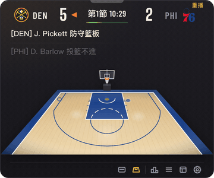
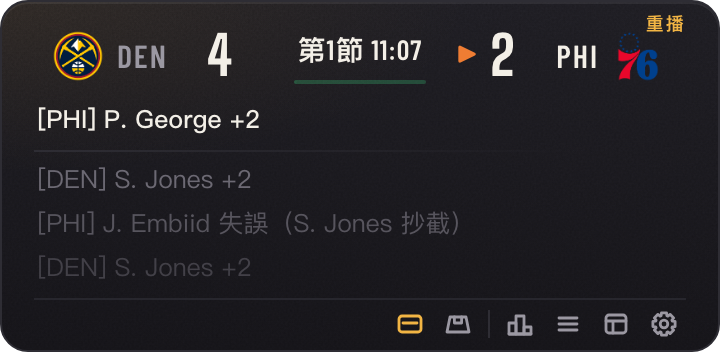
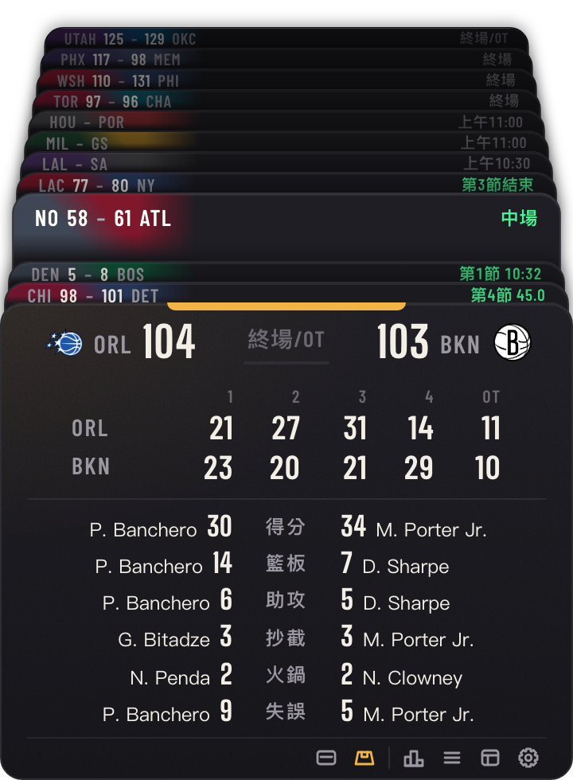
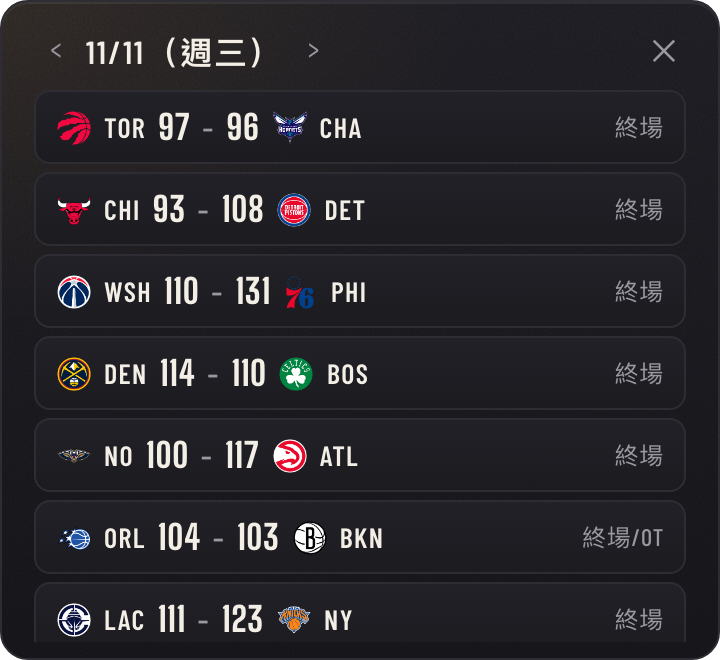
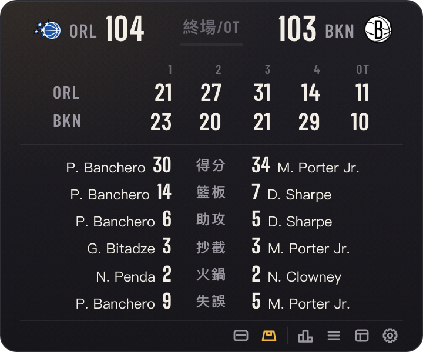
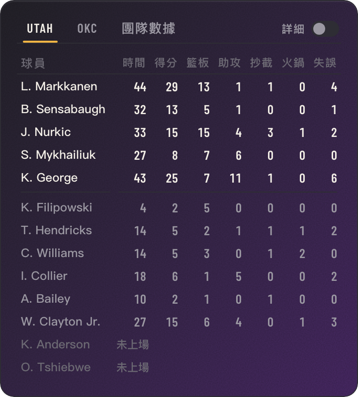
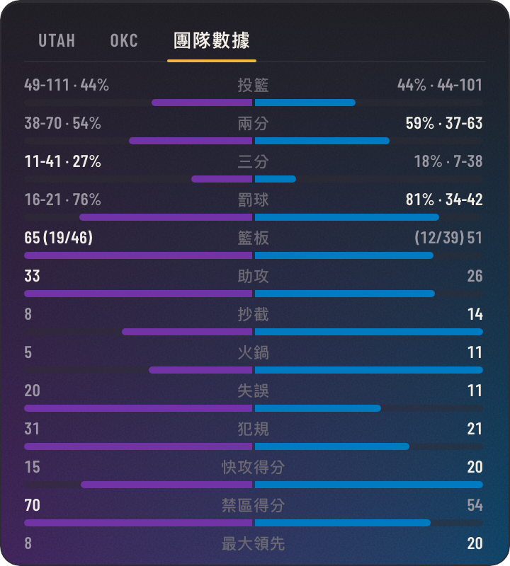
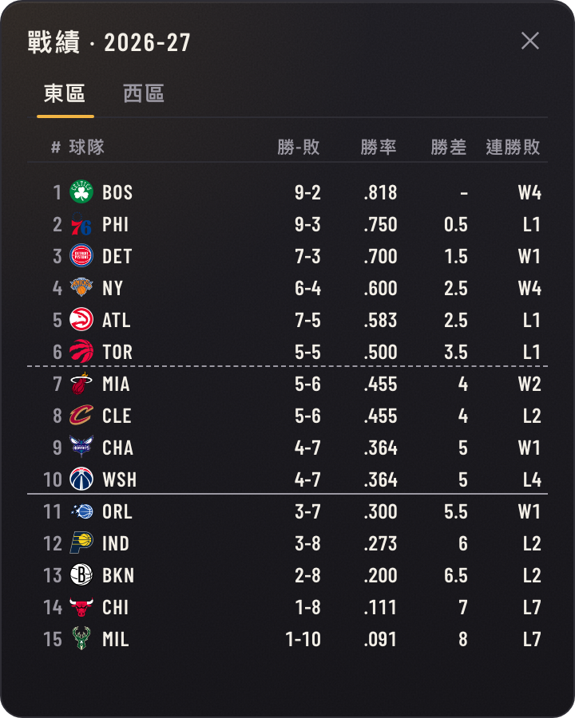

# Courtsmall

**把 NBA 收進桌面一角。** 一個非官方的桌面小工具，浮在螢幕角落顯示 NBA 即時比賽。上班不能看直播，也能一眼知道比分、誰在持球、剛剛誰投進。

<p>
  
  
</p>

## 功能

- **比分列**：兩隊隊徽與比分，中間是節次和時間。時間下的燈號：綠色是比賽進行中，紅色是暫停，灰色是結束。持球的一方有箭頭。
- **最近的事件**：得分、沒進、犯規、失誤、籃板、換人，最新的在最上面。連續得分會標出來，例如「BOS 10-0」。
- **球場模式**：3D 半場，每次出手照實際位置飛向籃框，進球會顯示得分。
- **快速切換比賽**：滑鼠移到主視窗上緣，當天其他比賽會像一疊卡片浮出，點一下就換過去。
- **數據視窗**：雙方球員數據、團隊數據、各節比分，用頁籤切換。點球員名字可以看本季場均和最近 5 場。
- **戰績表**：東西區排名、勝敗、勝率、勝差、連勝連敗。虛線以上進季後賽，實線以上進附加賽。
- **比賽列表**：當天所有比賽和比分。
- **開賽前**有倒數，**終場後**有各節比分和雙方各項最高。
- **最愛球隊**：自動跟它的比賽，比分列上用金色標出。
- **通知**：最愛球隊開賽、最後 2 分鐘差距 5 分內時通知。設定頁可以傳一則測試通知，確認收得到。
- **自動更新**：有新版本時，打開 App 會提醒，按一下就更新。
- **快捷鍵**（在任何程式裡都能用）：Ctrl+Alt+M（⌃⌥M）切換簡易／球場模式、Ctrl+Alt+S 數據、Ctrl+Alt+H 隱藏／顯示。
- 設定頁可以看更新日誌、寄信回報問題。
- 繁體中文、英文介面。

<p>
  
  
  
</p>

<p>
  
  
  
</p>

## 安裝

到 [Releases](https://github.com/ArthurWang322/Courtsmall/releases) 下載對應系統的安裝檔，不需要裝其他東西。

- **Windows**：下載 `-setup.exe`，安裝在目前使用者底下，不需要系統管理員權限。安裝檔沒有程式碼簽章，第一次執行若出現 SmartScreen 警告，按「其他資訊 → 仍要執行」。
- **macOS**：下載 `.dmg`（支援 Apple 晶片與 Intel），把 Courtsmall 拖進「應用程式」。App 沒有經過公證，第一次開啟時 macOS 會說無法驗證：按「完成」，再到「系統設定 → 隱私權與安全性」，往下捲到「安全性」，按 Courtsmall 旁的「強制打開」（或在終端機執行 `xattr -dr com.apple.quarantine /Applications/Courtsmall.app`）。之後就能正常開啟。第一次要發通知時 macOS 會詢問是否允許；若曾經不允許，要到「系統設定 → 通知 → Courtsmall」打開，macOS 不會再問。

主要在 macOS 上開發，Windows 版較新、測試較少。版本會持續更新，最新版都在 [Releases](https://github.com/ArthurWang322/Courtsmall/releases/latest)；0.5.0 起打開 App 時會提醒更新，之前的版本請到設定裡按「檢查更新」。

## 從原始碼建置

開發用。需要 Node.js（建議 24）與 Rust（[rustup](https://rustup.rs)）。

```bash
npm install            # 若使用 npm 10（Node 23）：npm install --legacy-peer-deps
npm test
npx tauri dev          # 執行 App
npx tauri build        # 建置 App 與安裝檔
```

推送版本標籤（`git tag v0.1.0 && git push --tags`）會在 GitHub Actions 建置 Windows 與 macOS 安裝檔，放進草稿 Release，檢查後再發布。發布前要先在 `src/changelog.ts` 寫好這個版本的更新內容：建置完成後會把它寫進更新檔，App 的更新畫面就是顯示這份；沒寫的話建置會失敗。

部分測試會拿 ESPN 的 box score 驗證資料轉換，需要先錄好的比賽資料（沒有放進版本控制）：

```bash
node scripts/probe/06-fixtures.mjs   # 存到 fixtures/nba/
```

`npm run dev` 可以只在瀏覽器裡開頁面；加上 `?game=<ESPN 比賽 id>&replay&fixture` 可重播錄好的比賽，再加 `&stackroom=225` 可預覽快速切換比賽的卡片，`&fakeupdate=0.5.0&from=0.4.2`（可再加 `&fakefail`）可模擬更新畫面。設計與資料實測的細節請見 `docs/PLAN.md` 與 `docs/PROBE_REPORT.md`。

## 資料來源

比賽資料來自 ESPN 公開的 site 與 core API，畫面上有比賽時由你的電腦每 10 秒直接抓取，沒有任何伺服器。Courtsmall 與 NBA、各球隊及 ESPN 均無關聯，也未獲其背書。球隊標誌在執行時從 ESPN 載入，不隨 App 散布，商標權屬各球隊所有。

## 已知問題

- ESPN 的賽程資料偶爾會晚一點才更新比賽時間；這時後方卡片與比賽列表只顯示節次，主視窗的時間不受影響。
- ESPN 有時會延遲發布或事後修正事件；比分一定正確，但偶爾某次得分可能只更新比分、沒有動畫。

## 致謝

改編自 Zaious（ChronicleCore Studio）的 [Basesmall](https://github.com/Zaious/basesmall)。字型：[Big Shoulders Display](https://fonts.google.com/specimen/Big+Shoulders+Display) 與 [Barlow Condensed](https://github.com/jpt/barlow)，皆採 SIL Open Font License 1.1 授權。

## 授權

[Apache License 2.0](LICENSE)。相關聲明請見 [NOTICE](NOTICE)。
