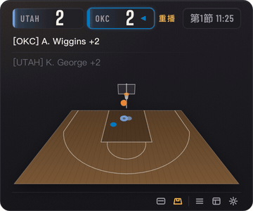
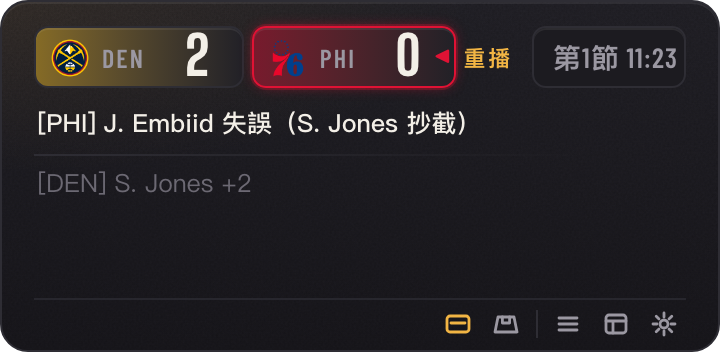
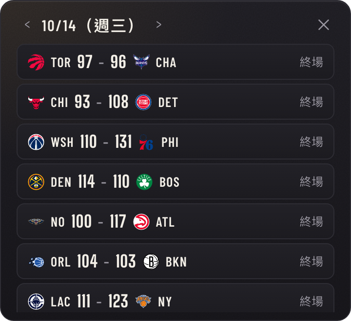
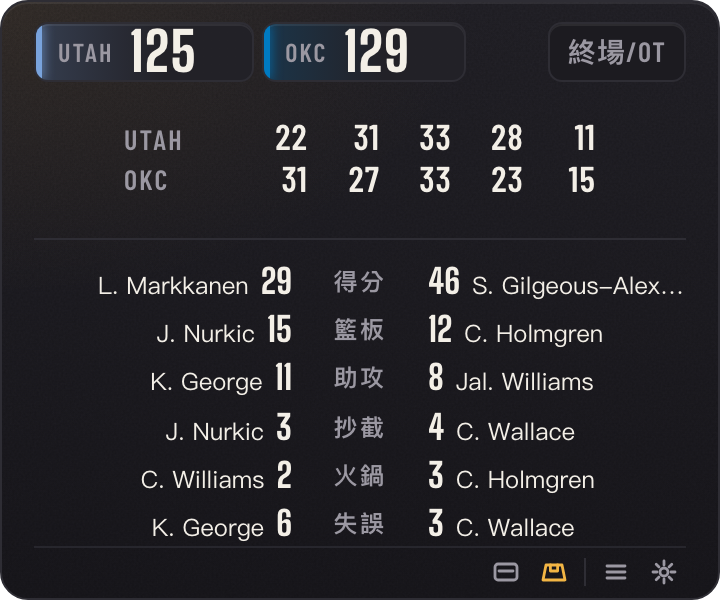
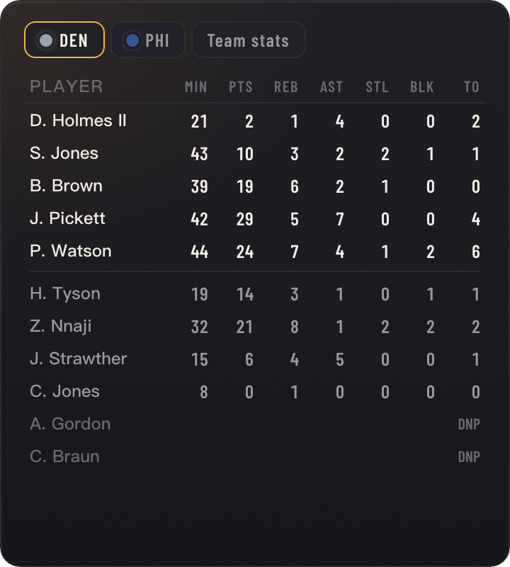
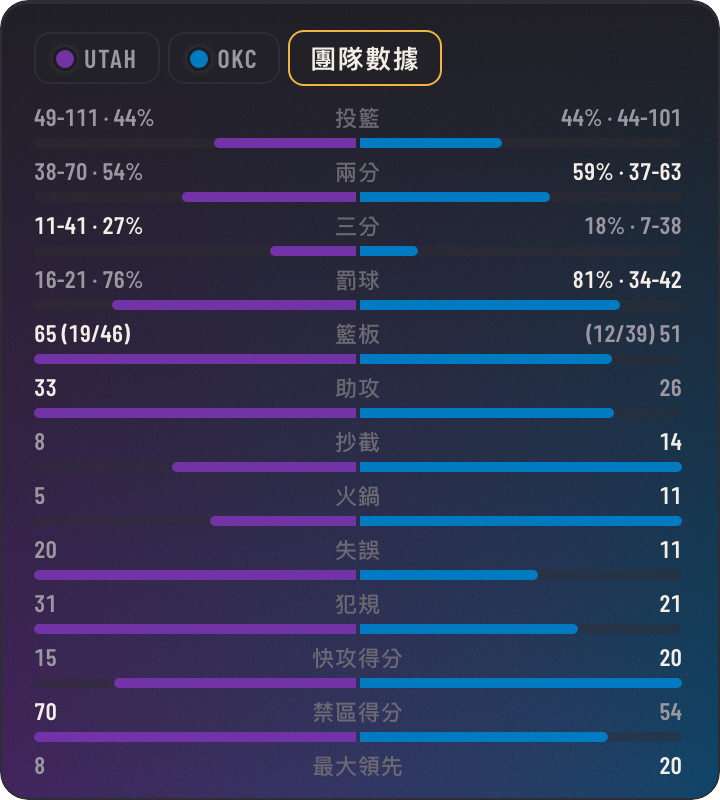

# Courtsmall

**把 NBA 收進桌面一角。** 一個非官方的桌面小工具，浮在螢幕角落顯示 NBA 即時比賽。上班不能看直播，也能一眼知道比分、誰在持球、剛剛誰投進。

<p>
  
  
</p>

## 功能

- **一眼看懂的比分**：每隊一格，附上隊徽，底色是球隊代表色由左往右漸淡；顯示節次與時間，持球的一方會加框。
- **最近兩筆事件**，最新的在上面：得分、沒進、犯規、失誤、籃板、換人，暫停與重播檢視會標上時間，連續得分以括號標在行尾。
- **3D 球場**：從三分線後方俯瞰半場，每次出手照實際位置飛向籃框，進球穿過籃網、沒進彈框而出，罰球從罰球線出手。球到籃框時文字和比分才更新，文字和畫面永遠對得上。
- **數據視窗**：從主視窗旁展開並跟著移動。雙方球員本場數據（場上球員標 *，先發與替補以分隔線區隔），背景換成該隊顏色的漸層；團隊數據以長條圖比較，背景混合兩隊顏色。下方是每節得分；已終場的比賽主視窗已有各節比分，就只展開旁邊的數據。
- **最愛球隊**：自動跟它的比賽，並在隊名後標星號；設定頁以它的隊徽當浮水印。沒設定時跟最接近的比賽。
- **比賽列表**：當天所有比賽，附上隊徽與比分。
- **開賽前**倒數，**終場後**顯示各節比分（標上節次與延長賽）與雙方各項領先者。
- **通知**：最愛球隊的比賽在開賽與關鍵時刻（最後 2 分鐘且差距 5 分內）通知，各自可以開關；沒選最愛球隊時不發通知。
- **更新日誌與回饋**：設定頁最下方可以查看每個版本的更新重點，或直接寄信回報問題。
- **全域快捷鍵**（在任何程式裡都能用）：Ctrl+Alt+M（⌃⌥M）切換簡易／球場模式、Ctrl+Alt+S 顯示數據、Ctrl+Alt+H 隱藏／顯示，可在設定裡開啟或關閉。
- 支援繁體中文與英文介面。

<p>
  
  
</p>

<p>
  
  
</p>

## 安裝

到 [Releases](https://github.com/ArthurWang322/Courtsmall/releases) 下載對應系統的安裝檔，不需要裝其他東西。

- **Windows**：下載 `-setup.exe`，安裝在目前使用者底下，不需要系統管理員權限。安裝檔沒有程式碼簽章，第一次執行若出現 SmartScreen 警告，按「其他資訊 → 仍要執行」。
- **macOS**：下載 `.dmg`（支援 Apple 晶片與 Intel），把 Courtsmall 拖進「應用程式」。App 沒有經過公證，第一次開啟時 macOS 會說無法驗證：按「完成」，再到「系統設定 → 隱私權與安全性」，往下捲到「安全性」，按 Courtsmall 旁的「強制打開」（或在終端機執行 `xattr -dr com.apple.quarantine /Applications/Courtsmall.app`）。之後就能正常開啟，新版本也能在設定裡直接更新。

主要在 macOS 上開發，Windows 版較新、測試較少。版本會持續更新，最新版都在 [Releases](https://github.com/ArthurWang322/Courtsmall/releases/latest)。

## 從原始碼建置

開發用。需要 Node.js（建議 24）與 Rust（[rustup](https://rustup.rs)）。

```bash
npm install            # 若使用 npm 10（Node 23）：npm install --legacy-peer-deps
npm test
npx tauri dev          # 執行 App
npx tauri build        # 建置 App 與安裝檔
```

推送版本標籤（`git tag v0.1.0 && git push --tags`）會在 GitHub Actions 建置 Windows 與 macOS 安裝檔，放進草稿 Release，檢查後再發布。

部分測試會拿 ESPN 的 box score 驗證資料轉換，需要先錄好的比賽資料（沒有放進版本控制）：

```bash
node scripts/probe/06-fixtures.mjs   # 存到 fixtures/nba/
```

`npm run dev` 可以只在瀏覽器裡開頁面；加上 `?game=<ESPN 比賽 id>&replay&fixture` 可重播錄好的比賽。設計與資料實測的細節請見 `docs/PLAN.md` 與 `docs/PROBE_REPORT.md`。

## 資料來源

比賽資料來自 ESPN 公開的 site 與 core API，畫面上有比賽時由你的電腦每 10 秒直接抓取，沒有任何伺服器。Courtsmall 與 NBA、各球隊及 ESPN 均無關聯，也未獲其背書。球隊標誌在執行時從 ESPN 載入，不隨 App 散布，商標權屬各球隊所有。

## 已知問題

- 系統通知目前還無法顯示，正在查原因。
- ESPN 有時會延遲發布或事後修正事件；比分一定正確，但偶爾某次得分可能只更新比分、沒有動畫。

## 致謝

改編自 Zaious（ChronicleCore Studio）的 [Basesmall](https://github.com/Zaious/basesmall)。字型：[Big Shoulders Display](https://fonts.google.com/specimen/Big+Shoulders+Display) 與 [Barlow Condensed](https://github.com/jpt/barlow)，皆採 SIL Open Font License 1.1 授權。

## 授權

[Apache License 2.0](LICENSE)。相關聲明請見 [NOTICE](NOTICE)。
